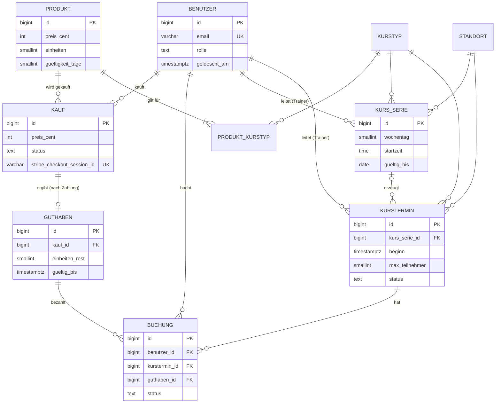

# Train and Tone – Datenmodell

Nov 23, 2026 · @Ari

## Kurzüberblick

Unser System speichert **10 Entitäten** (entities) in einer PostgreSQL-Datenbank. Dieses Dokument ist **Entwurf v0.1** und muss vom ganzen Team bestätigt werden, bevor wir den API-Vertrag (API contract) festlegen.

Ein **Datenmodell** (data model) beschreibt, *welche* Daten wir speichern und *wie sie zusammenhängen*. Es ist nicht dasselbe wie die API: Die API zeigt nur einen Teil davon nach außen. Der Passwort-Hash steht zum Beispiel im Modell, kommt aber nie in eine API-Antwort.

**So nutzt ihr das Dokument:**

1. Diagramm ansehen (5 Min.)
2. Abschnitt *Entscheidungen* lesen, denn dort steht das *Warum* (10 Min.)
3. Einwände als Kommentar direkt an die Stelle schreiben
4. Offene Fragen im nächsten Team-Meeting entscheiden

Das passende SQL-Skript (`train_and_tone_schema.sql`, PostgreSQL 16, getestet) liegt bei. Grundlage sind die Anforderungsspezifikation v0.8 und die User Stories US-01 bis US-08.

## ER-Diagramm

Der Kern ist die Kette **Kauf → Guthaben → Buchung → Kurstermin**: Jede Buchung weiß, von welchem bezahlten Block die Einheit kommt.

Lesen: `||--o{` = „eins zu null-oder-viele“ (1:n). `PRODUKT_KURSTYP` löst die n:m-Beziehung zwischen Produkt und Kurstyp auf. Alle Spalten stehen im nächsten Abschnitt und im SQL-Skript.

## Entitäten im Detail

Alle Tabellen haben `id` (BIGINT IDENTITY) als Primärschlüssel (PK). FK = Fremdschlüssel (foreign key). **Geld speichern wir in Cent als INT**, Zeitpunkte als TIMESTAMPTZ.

| Tabelle | Wichtige Spalten | Schlüssel & Regeln | Story |
| --- | --- | --- | --- |
| `benutzer` | vorname, nachname, email, telefon, passwort\_hash, rolle (KUNDE / TRAINER / ADMIN), muss\_passwort\_aendern, geloescht\_am | email UNIQUE (ohne Groß-/Kleinschreibung) | US-02, US-04 |
| `standort` | name, adresse, ist\_aktiv | name UNIQUE | US-03 |
| `kurstyp` | name, ist\_aktiv | name UNIQUE | US-01 |
| `produkt` | name, preis\_cent, einheiten, gueltigkeit\_tage, nur\_einmal\_kaufbar, ist\_aktiv | CHECK preis > 0, einheiten in (1, 3, 10) | US-01 |
| `produkt_kurstyp` | produkt\_id, kurstyp\_id | PK aus beiden Spalten (n:m) | US-01 |
| `kurs_serie` | name, wochentag (1–7), startzeit, dauer\_min, max\_teilnehmer, gueltig\_von, gueltig\_bis | FK kurstyp, standort, trainer | US-03 |
| `kurstermin` | kurs\_serie\_id (nullable), name, beginn, dauer\_min, max\_teilnehmer, status (GEPLANT / ABGESAGT) | FK serie, kurstyp, standort, trainer; Index auf beginn | US-03, US-05 |
| `kauf` | preis\_cent, einheiten, gueltigkeit\_tage (Kopie!), status, stripe\_checkout\_session\_id, bezahlt\_am | Stripe-IDs UNIQUE | US-06 |
| `guthaben` | kauf\_id, benutzer\_id, einheiten\_gesamt, einheiten\_rest, gueltig\_bis | kauf\_id UNIQUE (1:1), CHECK rest ≥ 0 | US-07, US-08 |
| `buchung` | benutzer\_id, kurstermin\_id, guthaben\_id, status, storniert\_am | UNIQUE (benutzer\_id, kurstermin\_id), nur für aktive Buchungen | US-07 |

Alle Fremdschlüssel sind `ON DELETE RESTRICT`: Die Datenbank verhindert, dass ein Datensatz gelöscht wird, auf den noch etwas zeigt.

## Entscheidungen und Begründungen

**1. Kurse = Serie + Termin.** Trainer:innen legen eine `kurs_serie` an (z. B. „jeden Dienstag 18:00 Reformer“). Das Backend erzeugt daraus echte Zeilen in `kurstermin`.

- *Warum echte Zeilen?* Eine Buchung braucht einen konkreten Datensatz als Ziel. Einen einzelnen Termin absagen heißt dann nur, den Status dieser einen Zeile zu ändern. Der Kalender ist eine einfache Abfrage nach Datum.
- *Warum Werte kopieren?* Ein Termin darf von der Serie abweichen (Vertretung, Absage). Einzelkurse haben `kurs_serie_id = NULL`.
- *MVP:* Serie mit fixem Enddatum, kein automatisches Verlängern.

**2. Guthaben pro Kauf, nicht als eine Zahl beim Benutzer.** Jeder Block hat ein eigenes Ablaufdatum und gilt nur für bestimmte Kurstypen. Mit einer einzigen Zahl wüssten wir nicht mehr, welche Einheit wann abläuft. `buchung.guthaben_id` zeigt, von welchem Block abgezogen wurde. Das brauchen wir auch, um bei einer Absage die Einheit zurückzugeben.

**3. Kauf speichert eine Kopie (snapshot) von Preis, Einheiten und Gültigkeit.** Ändert der Admin später ein Produkt, bleiben alte Käufe korrekt (Release 2: „Änderungen gelten nur für neue Käufe“).

**4. Eine Tabelle `benutzer` mit Spalte `rolle`.** Alle Rollen melden sich gleich an (US-04) und haben dieselben Felder. Drei Tabellen wären mehr Code ohne Nutzen.

**5. Konto löschen = anonymisieren.** Wir löschen die Zeile nicht, sondern setzen Name, Telefon und Passwort-Hash auf NULL, die E-Mail auf `geloescht-<id>@invalid` und `geloescht_am` auf jetzt. Kauf- und Zahlungsdaten bleiben für die Buchhaltung erhalten (Aufbewahrungspflicht 7 Jahre, § 132 BAO, vom Studio bestätigen lassen). Sie sind dann aber keiner Person mehr zuordenbar (DSGVO).

**6. Stripe statt eigener Kartendaten.** Wir speichern nur die Stripe-IDs. Die IDs sind UNIQUE, damit dieselbe Zahlung nie zwei Käufe oder zwei Guthaben ergibt (US-06).

**7. Geld in Cent (INT), Zeiten in UTC.** FLOAT rechnet ungenau (0,1 + 0,2 ≠ 0,3). TIMESTAMPTZ speichert intern UTC und vermeidet so Fehler bei der Sommerzeit-Umstellung. Ausnahme: `kurs_serie.startzeit` ist Wiener Ortszeit, denn „18:00“ soll auch im Sommer 18:00 bleiben.

**8. PostgreSQL-Funktionen, die wir bewusst nutzen.** Das Modell wäre in MySQL gleich, nur das SQL wäre anders:

- *Partieller Unique-Index* (`WHERE status = 'AKTIV'`): Doppelbuchungen sind verboten, aber nach einem Storno kann man neu buchen. MySQL kann das nicht direkt.
- *E-Mail eindeutig ohne Groß-/Kleinschreibung* über einen Index auf `lower(email)`.
- *TEXT + CHECK statt ENUM-Typ* für Rolle und Status: Das lässt sich später leichter ändern und passt gut zu EF Core.
- *Hinweis für C#:* EF Core mit dem Provider `Npgsql.EntityFrameworkCore.PostgreSQL`.

## Geschäftsregeln: wer garantiert was?

Faustregel: **Was die Datenbank garantieren kann, garantiert sie.** Das Backend prüft zusätzlich alles, was mehrere Zeilen oder Rollen betrifft. Das Frontend prüft nur für den Komfort, nie für die Sicherheit.

| Regel | Story | Datenbank | Backend |
| --- | --- | --- | --- |
| E-Mail nur einmal vergeben | US-02, US-04 | Unique-Index auf lower(email) | schöne Fehlermeldung (409) |
| Preis > 0, Einheiten 1/3/10 | US-01 | CHECK | Validierung mit Feldfehler |
| Keine Doppelbuchung | US-07 | partieller Unique-Index | Doppelklick → dieselbe Antwort |
| Kurs nie überbucht | US-07 | – | Transaktion: Termin mit `SELECT … FOR UPDATE` sperren, aktive Buchungen zählen, dann buchen |
| Guthaben nie negativ | US-07 | CHECK einheiten\_rest ≥ 0 | passendes, gültiges Guthaben wählen (das zuerst ablaufende) |
| Zahlung nur einmal gutgeschrieben | US-06 | Stripe-IDs UNIQUE, guthaben.kauf\_id UNIQUE | Webhook prüft Signatur, ist idempotent |
| Max. Teilnehmer nicht unter Buchungszahl | US-03 | CHECK > 0 | Vergleich mit aktiven Buchungen |
| Nur eigene Kurse bearbeiten (außer Admin) | US-03 | – | Rollenprüfung in der Service-Schicht |
| Admin-Konto nie löschbar | R3 | – | 403 Forbidden |
| Trainer:in nur löschbar ohne zukünftige Termine | R3 | FK RESTRICT als Sicherheitsnetz | Prüfung + Fehlermeldung |

## Offene Fragen ans Team

- [ ] Serie ändern (z. B. neue Uhrzeit): Gilt das nur für zukünftige Termine ohne Buchungen?
- [ ] Name als `vorname` + `nachname` (Vorschlag) oder ein Feld `name` wie in der Spezifikation?
- [ ] „Mehrere Plätze buchen“ (Release 2) widerspricht „eine aktive Buchung pro Person und Termin“. Brauchen wir dann eine Spalte `anzahl_plaetze` oder Gastbuchungen?
- [ ] Ändert der Admin die Kurstypen eines Produkts: Gilt das auch für bereits gekauftes Guthaben? (Wenn nein, brauchen wir eine Kopie der Kurstypen pro Kauf.)
- [ ] Wer verantwortet die Datenbank und die Migrationen (EF Core)? Bitte namentlich festhalten.

## So nutzt ihr das SQL-Skript

Wir nutzen PostgreSQL, deshalb funktioniert **MySQL Workbench nicht**. Nehmt stattdessen **pgAdmin 4** (kostenlos, hat ein ER-Diagramm-Werkzeug) oder DBeaver.

1. PostgreSQL 16 installieren, pgAdmin 4 öffnen (ca. 15 Min.)
2. Rechtsklick auf *Databases* → *Create* → Name `train_and_tone`
3. Datenbank wählen → *Query Tool* → `train_and_tone_schema.sql` öffnen → Ausführen (F5)
4. Rechtsklick auf die Datenbank → *ERD For Database*: pgAdmin zeichnet das Diagramm aus den echten Tabellen

**Später im Projekt:** Das Skript ist unsere Diskussionsgrundlage. In der App erzeugen wir die Tabellen mit EF-Core-Migrationen (Code First). Die C#-Entity-Klassen müssen dann genau dieses Modell abbilden.

Das Skript ist auf PostgreSQL 16 getestet: Doppelte E-Mail, Doppelbuchung, doppelte Stripe-Zahlung, negatives Guthaben und Löschen eines Benutzers mit Käufen werden von der Datenbank abgelehnt. Neu buchen nach Storno funktioniert.
